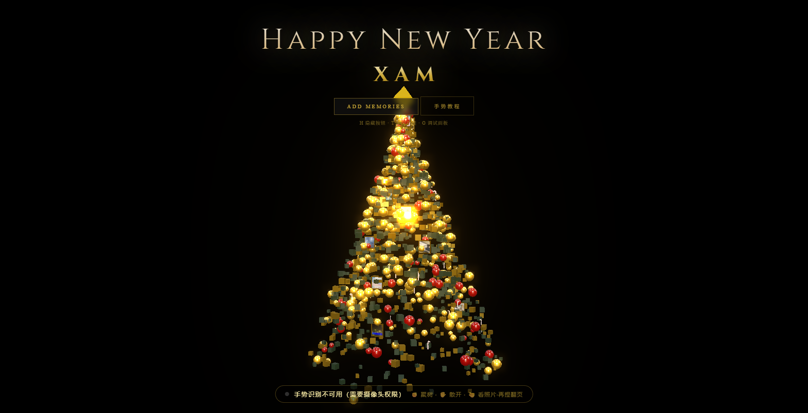

# Happy New Year · XAM

一个用**手势控制**的 3D 新年树 —— Three.js + MediaPipe Hands，纯前端、离线可跑。



## 这是什么

打开摄像头，用手就能玩：

- ✊ **握拳** → 所有装饰物飞回螺旋树形
- 🖐 **张开五指** → 全部散开，左右移动手掌可以 360° 转动视角
- 🤏 **捏合** → 放大一张照片看，**每捏一次翻下一张**，握拳回树

树由 1500+ 个金色/深绿粒子（球、方块、拐杖糖）沿螺旋分布，加 2500 个浮动尘埃，配 UnrealBloom 泛光。

## 运行

摄像头权限要求 **localhost 或 https**，所以不能直接双击 html，要起个本地服务器。

**Windows（推荐）**

双击 `启动圣诞树.bat` —— 会自动启动 Python 静态服务器并打开浏览器。

**手动**

```bash
python -m http.server 8765
# 浏览器打开 http://localhost:8765/christmas-tree-gesture.html
```

> 另一个 `christmas-tree.html` 是纯 Canvas 2D 的粒子版本，不依赖 three.js，可直接双击打开。

## 手势对照表

| 手势 | 效果 | 要点 |
| --- | --- | --- |
| ✊ 握拳 | 聚拢成树 | 四指弯向掌心，拇指可自然压在侧面 |
| 🖐 张开五指 | 散开 | 五指伸直张开；散开后左右移动手掌转视角 |
| 🤏 捏合 | 看照片 | 拇指与食指指尖相触，保持约 0.2 秒；每捏一次翻一张 |
| ↔ 左右划动 | 翻照片 | 特写状态下左划上一张、右划下一张 |

快捷键：`T` 手势教程 · `G` 识别调试面板 · `H` 隐藏按钮 · `Esc` 关闭教程

### 识别是怎么做的

判定不依赖"像素距离"，而是：

1. **尺度无关**：所有距离除以掌心尺寸（手腕 → 中指根），手大手小、离镜头远近都不影响
2. **关节弯曲度**：用 `弦长 / 骨长` 判断手指是否伸直，配合指尖到手腕的距离排除透视误差
3. **滞回阈值**：每个手势有独立的进入/退出阈值，临界点上不会疯狂抖动
4. **多帧投票**：连续 5 帧一致才切换模式，并有 300ms 冷却
5. **不误伤**：剪刀手、单指、半握不会触发，识别不到时保持现状

捏合的"一次动作只翻一张"由上升沿脉冲保证：一直捏着只算一次，松开再捏才翻页。

## 目录结构

```
.
├─ christmas-tree-gesture.html   手势版主页面（Three.js）
├─ christmas-tree.html           2D Canvas 粒子版
├─ main.js                       场景 / 渲染 / UI 主逻辑
├─ gesture-engine.mjs            手势识别引擎（纯逻辑，可单测）
├─ 启动圣诞树.bat                 一键起服务器 + 开浏览器
├─ 重新打包.bat                  用 esbuild 把 main.js 打包成 bundle.js
├─ tools/esbuild.exe             打包器（离线可用）
└─ assets
   ├─ bundle.js                  打包产物（页面实际加载的就是它）
   ├─ hand_landmarker.task       MediaPipe 手部模型
   ├─ wasm/                      MediaPipe WASM 运行时
   ├─ photos/                    树上挂的照片
   └─ lib/                       打包用依赖清单（three / tasks-vision）
```

## 修改与重新打包

页面加载的是 `assets/bundle.js`，它由 `main.js` 打包生成：

1. 先装打包依赖（只需一次）
   ```bash
   cd assets/lib && npm install
   ```
2. 改 `main.js` / `gesture-engine.mjs`
3. 双击 `重新打包.bat`（或直接调用 `tools\esbuild.exe`）
4. 浏览器 `Ctrl+F5` 强刷

手势灵敏度在 `gesture-engine.mjs` 的 `DEFAULT_CONFIG` 里调：`smooth.gain` 越大越灵敏、`smooth.dead` 是死区、`smooth.follow` 是跟手速度。

## 技术栈

- [three.js](https://threejs.org/) r160（渲染、Bloom、环境光）
- [MediaPipe Tasks Vision](https://developers.google.com/mediapipe) 0.10（手部 21 关键点）
- [esbuild](https://esbuild.github.io/)（打包）

## 说明

- 手势识别需要摄像头权限；模型文件约 7.5MB，首次加载会稍慢
- 照片可在页面里点 **Add Memories** 自己上传
